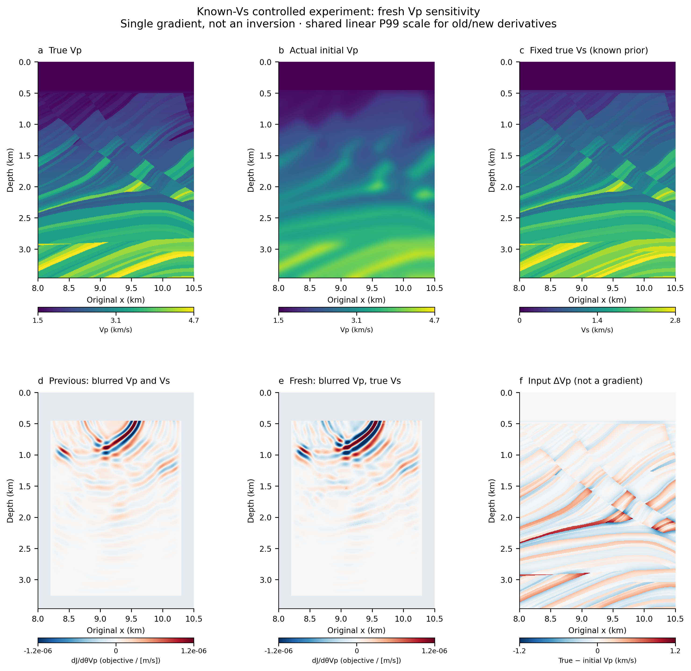
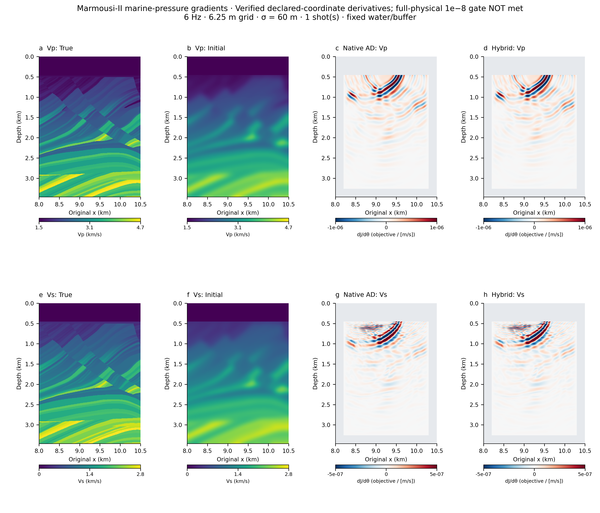
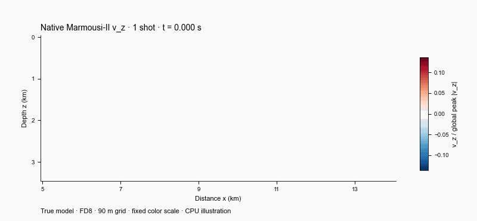
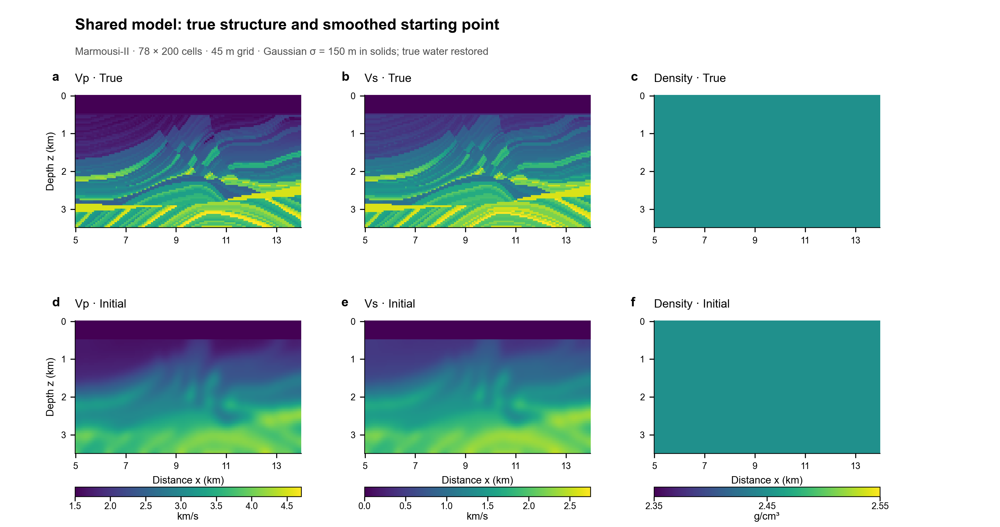
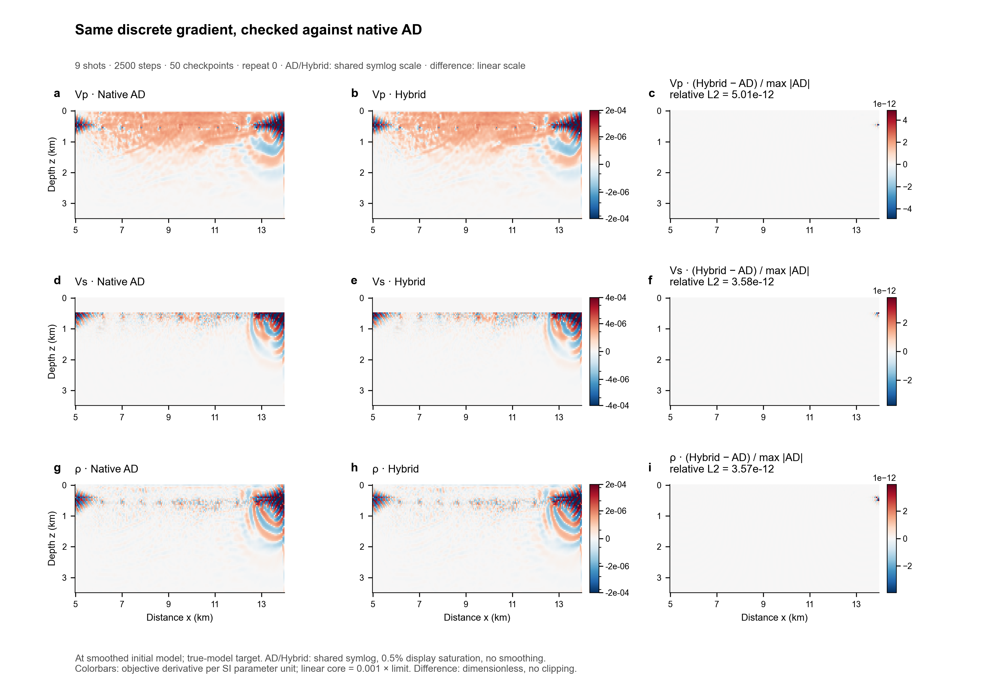
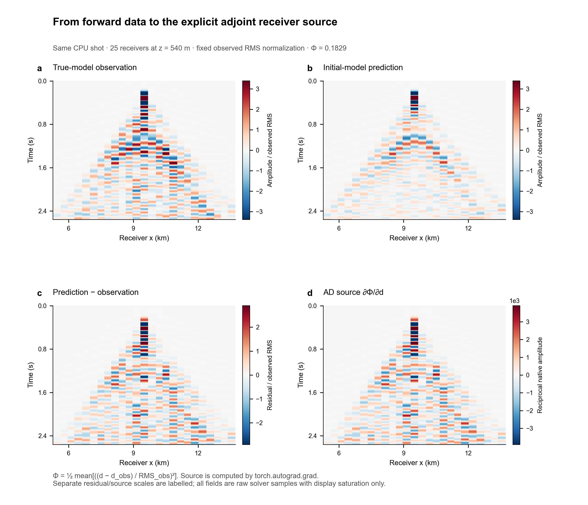
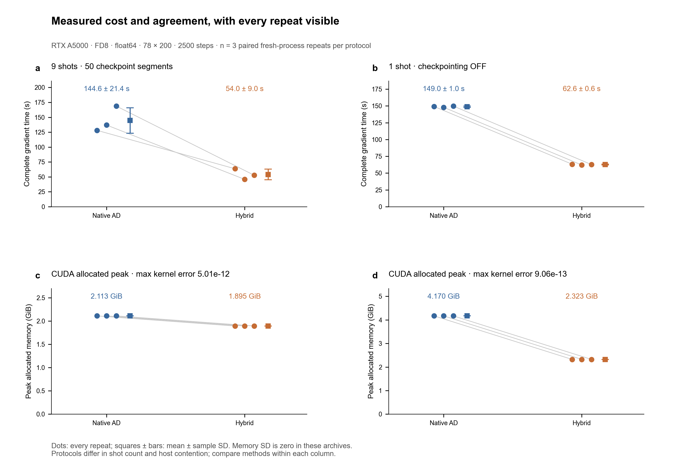

# HybridADFWI

在**同一个 ADFWI 原生正演算子**上，对比完整自动微分与混合离散伴随：波形是否一致、Vp/Vs/ρ 梯度是否一致、时间与内存实际节省多少。ADFWI 本身已可微；本项目保留其原生 PSV / FD8 / split-PML 内核，用显式离散伴随替换时间传播的 AD 图。

HybridADFWI compares native AD with an external discrete adjoint for an already-differentiable solver. The validated scope is **2-D isotropic elastic PSV, float64, first-order Vp/Vs/ρ gradients**. This is a controlled research benchmark; SPECFEM and AxiSEM3D adapters are separate projects.

## 已知真实 Vs：Vp 单参数对照

固定真实 Vs 与既有恒定密度，只模糊 Vp，重新正演、求 VJP 和伴随梯度。**完整物理 Vp 梯度与 AD 的相对误差为 2.76e−11**，实际反演坐标误差为 1.87e−15，均通过原定门槛。

[](docs/VP_ONLY.md)

这一组没有增加明显的 Marmousi 薄层细节；新旧梯度使用相同色标，深部平方范数占比反而下降。单次冷运行中 Hybrid 的 allocated 显存也略高于 AD，均在[结果、参数与复现报告](docs/VP_ONLY.md)中保留。

## 新增：Marmousi-II 层状梯度演示

这组独立示例使用 **6.25 m 网格、6 Hz、水层压力数据**，在完整深度的水平 ROI 上显示真实模型、平滑初始模型及两种方法的实际梯度。吸收边界和固定数据窗经过单独检查；AD 与 Hybrid 使用完全相同的正演和目标函数。图中灰色区域是声明的固定参数，完整物理梯度另图展示。

当前验证范围是**预先声明的反演坐标梯度 Pᵀg**；辅助完整物理梯度未达到原定严格门槛，原始失败结果保留，见报告中的逐项误差。此例不声明完整物理 VJP 全部通过。

[](docs/GRADIENT_DETAIL.md)

[参数选择、失败控制与数值验证](docs/GRADIENT_DETAIL.md)。梯度显示局部敏感度，尚不是反演重建；下列原始性能基准及其可视化配置保留。



真实 Marmousi-II 模型上的原生 `v_z` 波场，固定色标；星号与接收器位置见[静帧与几何](docs/figures/wavefields.png)。此动画来自新运行的 **39×101 / 90 m / 单炮 / CPU** 可视化示例，完整 GPU 对比使用下表所列另一配置。

| 真实模型与平滑初始模型 | Native AD / Hybrid 梯度与差值 |
| --- | --- |
| [](docs/VISUAL_REPORT.md#model) | [](docs/VISUAL_REPORT.md#gradients) |
| 观测、初始预测、残差与 AD 伴随源 | 时间、显存与全部三次重复 |
| [](docs/VISUAL_REPORT.md#data) | [](docs/VISUAL_REPORT.md#measurements) |

[完整可视化报告](docs/VISUAL_REPORT.md) 包含六张图的说明、梯度[逐参数逐重复误差](docs/figures/agreement.png)、PNG/PDF/SVG、色标变换与数据来源。图中没有伪造波场或反演重建；梯度在**平滑初始模型**处对真实模型生成的观测求导，没有梯度平滑。Marmousi-II 来源：University of Houston / AGL，Gary S. Martin、Robert Wiley、Kurt J. Marfurt；[数据条款](docs/DATA_PROVENANCE.md)独立于代码许可。

## 已归档的实测结果

RTX A5000；两条路径均使用 78×200 / 45 m、2500 步、FD8、float64 和相同输入。时间为三次独立进程测量的均值 ± 样本标准差；显存为 CUDA **allocated** 峰值。

| 配对配置 | Native AD 时间 | Hybrid 时间 | Native AD / Hybrid 显存 | 最大梯度相对 L2 误差 |
| --- | ---: | ---: | ---: | ---: |
| 9 炮，双方 50 段 checkpoint | 144.62 ± 21.41 s | 54.01 ± 8.98 s | 2.113 / 1.895 GiB | 5.01e−12 |
| 1 炮，双方关闭 checkpoint | 149.00 ± 0.96 s | 62.64 ± 0.59 s | 4.170 / 2.323 GiB | 9.06e−13 |

两组全部重复的接收波形均逐位一致。9 炮测量存在 CPU 争用；两组炮数及主机条件不同，只能在各组内比较方法。9 炮无 checkpoint 时 Native AD 显存不足，Hybrid 可完成、峰值 20.83 GiB；失败尝试不计为完整梯度时间。详见[checkpoint 报告](docs/RESULTS_20261106.md)、[无 checkpoint 报告](docs/NO_CHECKPOINT_RESULTS_20261106.md)与[原始证据](evidence/README.md)。

## 两条路径

| 环节 | ADFWI 原生 AD | HybridADFWI |
| --- | --- | --- |
| 正演 | 原生 FD8 / split PML | 同一个原生内核 |
| 时间传播求导 | 时间 AD 图；可 checkpoint 重算 | 显式离散伴随；分段重算或完整历史 |
| 目标函数与数据导数 | PyTorch AD | PyTorch AD，显式 `grad(loss, data)` |
| Vp/Vs/ρ 梯度 | 对传播与材料映射 AD | 离散伴随 + 静态材料映射 VJP |

伴随显式转置原生更新、接收采样、split PML 与自由表面赋值。上游文件保持不变；两边共享保留输入 dtype 的外部 padding 适配器与原生 float32 生成的 FD 常数。只支持一阶模型梯度，源、几何与阻尼固定；不包含优化器或完整反演。见[实验协议](docs/EXPERIMENT.md)。

## 开始复现

```bash
git clone --recurse-submodules https://github.com/Wangxi404/HybridADFWI-Open.git
cd HybridADFWI-Open
python -m pip install -e '.[test]'
python -m pytest -q
python scripts/prepare_marmousi.py --preset smoke
python scripts/benchmark.py run --preset smoke --device cpu --repeats 1 --output runs/smoke
```

CPU 测试不下载外部数据。Marmousi 准备脚本直接从 AGL 下载并校验来源；原始和准备后的输入数组不随仓库分发。源代码检出及固定上游 submodule 是运行所需条件；独立 wheel 不含全部运行资源。

| 参数 | GPU 证据 | 波场 / 伴随源可视化 |
| --- | --- | --- |
| 模型网格 | 78×200，45 m | 39×101，90 m |
| 时间 | 2500×3 ms | 640×4 ms |
| 炮 / 接收器 | 9 或 1 / 100 | 1 / 25 |
| 源 / 深度 | 5 Hz Ricker / 540 m | 同左 |
| 初始模型 | 固体区高斯 σ=150 m，恢复水层；ρ=2450 kg/m³ | 同一准备规则 |
| 波场 / 梯度精度 | float64 | float64 |

重建本页图片：

```bash
python scripts/prepare_marmousi.py --preset paper
python scripts/visualize.py
```

脚本读取归档 GPU 证据，只在本机运行一段 CPU 原生波场，不重跑 GPU 基准。更多参数与缓存说明见[可视化报告](docs/VISUAL_REPORT.md#reproduce)。GPU 空闲门控、硬件要求、完整基准命令及真正关闭 checkpoint 的说明见[复现指南](docs/REPRODUCIBILITY.md)。`--segments 1` 本身不会关闭 checkpoint；需要 `--no-checkpoint`。

同配置容量检查可使用 `scripts/check_no_checkpoint_capacity.py --reference-protocol <已有协议> --output <新目录>`，保留 OOM 阶段与显存记录，不填充缺失梯度误差。

代码：[MIT License](LICENSE)。固定上游：[ADFWI](https://github.com/liufeng2317/ADFWI)，commit `559f581149343b1ed3dd2168caae595690bd601d`；版权与数据声明见[Third-party notices](THIRD_PARTY_NOTICES.md)。
