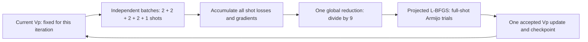

# Full-shot Marmousi-II Vp inversion

This experiment advances beyond an initial sensitivity map into an actual
accepted model trajectory. **Every iteration uses all nine independent shots
at one current model before one accepted update.** It is a separate inversion
demonstration, rather than a replacement for the matched AD/Hybrid correctness
and memory benchmarks.



The batches contain independent wavefields; sources are not encoded together.
Each shot loss is a mean over its time/receiver samples. Each batch returns a
**sum** over its actual shots. The complete reduction divides by nine once,
including the one-shot final batch. Every provisional line-search candidate
also evaluates all nine shots at that fixed candidate. Rejected trials do not
update the accepted model.

| Item | Declared protocol |
| --- | --- |
| Solver | Unchanged ADFWI P–SV step kernels; spatial FD order 8; float64 |
| Model | Marmousi-II ROI, original x = 8–10.5 km; depth = 0–3.4625 km |
| Grid | 555 × 401 points, 6.25 m spacing |
| Unknown | Vp, starting from the previously declared sigma = 60 m blur |
| Known priors | True Vs and designated density; fixed water and parameter buffer |
| Sources | Nine independent 6 Hz Ricker sources, x = 8.05–10.45 km, spaced 300 m |
| Records | 161 receivers per shot; 7001 samples at 0.5 ms |
| Stages | 3 Hz low-pass: at most 8 accepted epochs; 4.5 Hz: 12; full source band: 40 |
| Optimizer | L-BFGS memory 5; clear history at each stage change; projected Armijo |
| Step bound | Actual mapped Vp change at most 60 m/s per accepted update |
| Material bounds | Positive isotropic bulk from fixed Vs; Vp at most 6000 m/s |
| Propagation route | Native no-temporal-graph forward; data AD VJP; explicit propagation adjoint |
| Native tape | 84 checkpoint segments; this is not the separate no-checkpoint memory experiment |
| Stop | Declared stage caps or data/step-based criteria; no true-Vp error feedback |

The training container **physically omits unknown true Vp**. Observations are
generated separately. True Vp is accessible to the offline figure/evaluation
reader only. The fixed true Vs is a strong synthetic prior; reconstruction
quality under that prior must not be presented as unconstrained joint FWI.

## Correctness and execution evidence

The run preserves per-batch model fingerprints, shot IDs, objective IDs,
normalization and complete-candidate proofs. Accepted model checkpoints,
actual mapped updates and the full-shot ledger support independent replay.
Resume rejects changed source/configuration/training/observation fingerprints.
Interrupted partial batches may be reused only at their exact verified point.

CPU qualification covers actual small wave solves, batch/serial reductions,
AD/Hybrid agreement and full-objective directional checks. Separate tiny
control-flow tests inject interruption and invalid provenance into the actual
optimizer/ledger machinery; these do not substitute for seismic derivative
checks. See [independent review evidence](../evidence/multishot_fwi_independent_review/).

The initial diagnostic used maximum physical perturbations of 0.10 and
0.05 m/s. Their actual relative errors were 1.1924e−5 and 1.3943e−6, against
the unchanged 1e−5 tolerance. That original run is retained as a failed
qualification with zero accepted updates. The refined diagnostic uses 0.05
and 0.025 m/s and requires **both** to pass. Two points alone do not establish
a convergence order. This changes diagnostic step sizes only.

`scripts/import_fwi_diagnostic_cache.py` can reuse verified initial-point
results for this diagnostic-only refinement. It checks identical numerical
sources, fields, geometry, observations and objective, preserves the producer
metadata/signature and records a separate compatibility proof. It never
rewrites the original failure or relabels old arrays as new computations.

The shared-host supervisor uses one quiet logical CPU and low priority. It
starts only with an eligible GPU, reserves 2 GiB, and terminates **its own
worker only** if foreign compute appears. Graphics-only tasks are permitted.
Checkpoint resume retains the accepted model. A resource pause, failed
qualification or epoch cap must never be labelled as convergence.

## Run and inspect

```bash
python scripts/marmousi_fwi.py prepare-inputs --config configs/fwi_20261108_vponly_fdrefined.json
python scripts/marmousi_fwi.py observations --config configs/fwi_20261108_vponly_fdrefined.json \
  --output OBSERVATIONS_NPZ
python scripts/run_multishot_fwi.py --config configs/fwi_20261108_vponly_fdrefined.json \
  --observations OBSERVATIONS_NPZ --output RUN_DIRECTORY
```

On a shared GPU, use `scripts/fwi_supervisor.py` around the worker command;
the direct invocation above does not perform GPU arbitration. Preparation
requires the existing locally acquired model inputs and their documented terms.
Use a fresh namespace for a changed numerical protocol.

[Figure outputs and offline reproduction](FULL_SHOT_FIGURES.md) distinguish
raw total derivatives, search directions, actual updates, model recovery and
data fit. Plots must state the actual accepted count and completion status.
