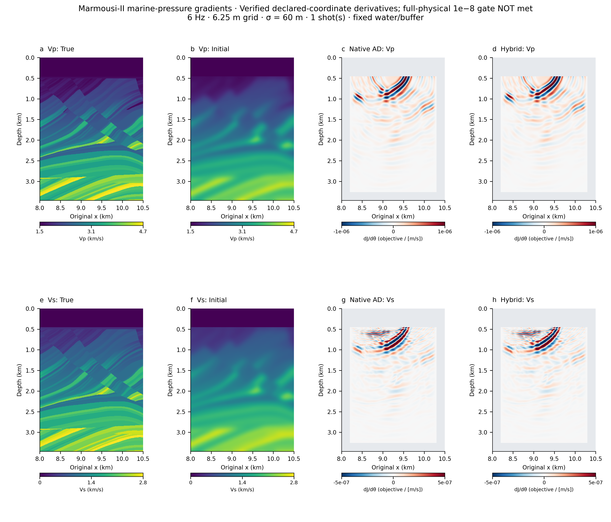
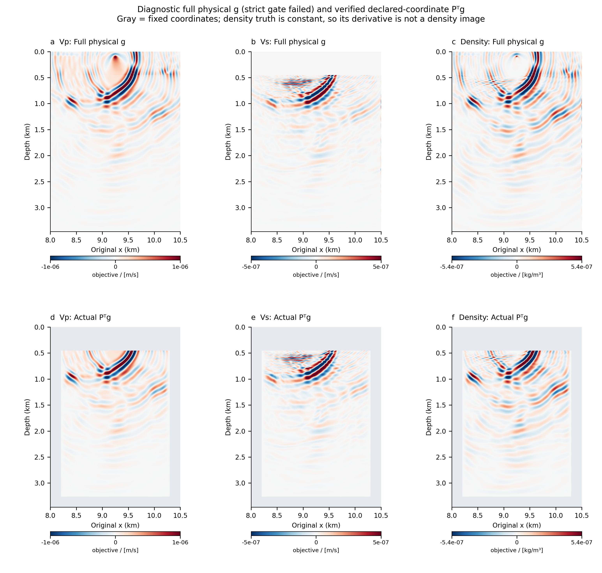

# A separate experiment for geological gradient detail

The original benchmark answers whether HybridADFWI matches native AD and how
their measured resources compare. Its gradient display is dominated by water
and lateral-boundary sensitivities. It is not a validated high-resolution
imaging example. The original arrays, timings and comparison remain unchanged.

**Numerical scope:** the final example validates the derivative with respect
to the predeclared inversion coordinates, `dJ/dtheta = P^T g`. Their AD/Hybrid
relative errors are approximately 10⁻¹². The auxiliary full-physical gradients
do **not** meet the original 10⁻⁸ all-physical gate; `summary.json` remains
`passed: false`. They are retained as diagnostics, with the failed gate visible
on both figures. Independent coordinate/quality acceptance is recorded
separately and never rewrites the original all-physical result.



This new pressure-data experiment uses a **horizontal Marmousi-II ROI**,
x = 8…10.5 km, retaining depth 0…3.4625 km. It is not the complete Marmousi-II
extent. True and initial models are regenerated from the same checksum-verified
AGL SEG-Y sources on the finer grid. The initial model is sigma = 60 m Gaussian
smoothing within solid, with known water restored. It is a closer starting
model than the old sigma = 150 m benchmark, and is explicitly shown.

| Setting | Original performance benchmark | New detail example |
|---|---|---|
| Model samples / spacing | 78×200 / 45 m | 555×401 / 6.25 m |
| Source frequency | 5 Hz | 6 Hz |
| Source and receiver depth | 540 m, solid | 100 m, water |
| Data | Vertical velocity | Pressure from native normal stresses |
| Source coverage | 9 independent shots | One central shot (index 1 of a three-position geometry) |
| Receivers | 100 requested | 161 requested |
| Record | 2500×3 ms = 7.5 s | 7001×0.5 ms ≈ 3.5 s |
| Starting-model smoothing | 150 m | 60 m |
| Boundary damping | Native per-model maximum-Vp profile | One fixed reference profile for truth, initial and derivatives |
| Boundary condition | Free surface, 32-cell PML | Absorbing top, 96-cell / 600 m PML; no ocean-surface ghost |
| Data window | Unweighted velocity residual | Fixed known-water seafloor-primary mute, offset/time tapers |
| Active coordinates | Full physical fields | Solid ROI with a fixed water/lateral/bottom buffer map |
| Purpose | Numerical agreement and resource benchmark | Separate functional demonstration; timings are not a benchmark |

Pressure is the actual native quantity `-(txx+tzz)/2` at fluid receivers. Fixed
smooth offset/time weights define the scalar data objective; they are included
in the AD graph. The time gate starts after the known water-layer primary,
using water depth 450 m, water speed 1500 m/s, source/receiver depth 100 m,
and a 0.25 s delay with a 1/6 s smooth onset. These known-water quantities do
not use true solid-layer travel times. This excludes primary data, rather than
guaranteeing removal of all shallow-model sensitivity or separating every wave
mode. The same observations, weights and normalization are used for AD and
Hybrid. The production Hybrid path still uses no temporal autograd.

## Physical gradients and parameter-coordinate gradients



We save two different derivatives:

```
m(theta) = m_initial + P (theta - m_initial)
physical derivative: g = dJ/dm
coordinate derivative: dJ/dtheta = P^T g
```

`P` is a fixed diagonal map: zero in known water and the lateral/bottom buffer,
with a raised-cosine transition to the free interior. Buffer reference values
come from the **initial model**, not the unknown true boundary structure.
The realized starting field equals the displayed smoothed model exactly.
Observed data use the original true ROI without this parameter map; errors in
the fixed buffer can therefore remain irreducible.

The native AD baseline differentiates this map. Hybrid computes the full
physical derivative and applies the same exact static transpose. Gray denotes
fixed coordinates. The constrained derivative is a real chain-rule result,
not a posthoc image-cleaning mask. Full physical derivatives are shown beside
it rather than hidden. Density is constant in the true and initial controls;
its sensitivity is not a density reconstruction.

## Why the old picture was hard to interpret

For the old 9-shot case, water contains about 89.07% of the Vp gradient's
squared norm and 63.49% of density's. Within solid, the two 200 m edge strips
contain about 86.76% / 89.65% / 86.96% for Vp/Vs/density. These are squared
Euclidean gradient fractions, not mechanical energy or a comparison of
different physical parameter units.

The upstream PML profile is generated from `vp.detach().max()`: true and
initial models produce different damping strength. A matched control that
changes only the initial profile to the exact true reference changes the
three raw derivatives by roughly 50.25% / 47.92% / 49.89%, while the solid
edges still contain 89.00% / 87.75% / 82.83% of the squared norm. Thus damping
mismatch contributes substantially but is not a sufficient explanation for
the edge dominance. This single-factor control is separate from the new ROI.

The old 45 m, 5 Hz configuration also has only about 1.41 grid points per
wavelength at the slowest positive shear speed. CFL stability and AD/Hybrid
agreement establish neither physical imaging resolution nor continuum accuracy.
The new configuration's native FD8 plane-wave analysis gives about 8.1 points
per slowest-S wavelength at 6 Hz. Its homogeneous axial phase error is about
−0.25% at 12 Hz and −1.16% at 15 Hz; the Ricker spectral amplitudes there are
about 20% and 3.3% of peak. This is an explicitly bounded sampling analysis,
not a heterogeneous/interface convergence study. The actual data-window
cotangent can have a broader spectrum, which is reported separately.

## A forward-quality check before accepting a better-looking gradient

The first full-depth fine-grid run passed the discrete AD/Hybrid comparison
but developed a late-time lateral water–solid corner amplification. A correct
derivative of that numerical response is not a useful geological illustration.
We retain this run as a **rejected physical-quality case** and do not use it in
the new gallery. Increasing a display threshold or masking its large gradients
would not repair the forward calculation.

| Same fine-grid 3.5 s recording, before any data mute | Initial pressure max at 3–3.5 s | Observed pressure max | Assessment |
|---|---:|---:|---|
| Free surface, 200 m PML | 11.913 | 0.00425 | Rejected late amplification |
| Absorbing top, 200 m PML | 8.119 | 0.00180 | Rejected; changing the top alone is insufficient |
| Absorbing top, 600 m PML | 0.0007933 | 0.001818 | Decaying traces over this record; used for the final candidate |

The last control changes only PML thickness relative to the absorbing-top
control. Its stable unmuted traces are also checked against the final gradient
run. The separate no-gradient control and final native recording are not
bitwise identical for the initial prediction: their relative L2 difference is
5.55×10⁻⁹ (absolute maximum 1.23×10⁻⁸), with its cause unresolved. The true
observations are bitwise identical, as are the matched AD/Hybrid predictions.
These finite-record checks are not a proof of unconditional stability or
a heterogeneous convergence study. Absorbing-top physics is declared explicitly;
it differs from the original free-surface benchmark.

## Display and numerical evidence

The new plots use a linear symmetric 99th-percentile display scale computed
over fully active coordinates. AD and Hybrid share the same scale per
parameter. All grid samples are retained, and every panel's saturation
fraction is reported. Derivative arrays receive no smoothing, sharpening,
illumination division or depth gain. True-model texture is never used to
decorate a gradient.

The recorded receiver pressure is **bitwise equal** for AD and Hybrid, and
both objective values are exactly 0.3727100131527949. Using the unchanged
10⁻⁸ numerical tolerance:

| Actual inversion-coordinate derivative | AD/Hybrid relative L2 error | Coordinate gate |
|---|---:|---|
| Vp | 7.82×10⁻¹³ | Passed |
| Vs | 3.11×10⁻¹³ | Passed |
| Density | 5.95×10⁻¹⁴ | Passed |

| Auxiliary full-physical derivative | AD/Hybrid relative L2 error | Original 10⁻⁸ gate |
|---|---:|---|
| Vp | about 3.42×10⁻⁸ | Failed |
| Vs | about 3.10×10⁻⁷ | Failed |
| Density | about 3.39×10⁻⁸ | Failed |

Independent region checks locate more than 99.99999998% of the squared
full-physical discrepancy in `P=0` water/buffer coordinates. Core errors are
below 7.3×10⁻¹³ and transition-region errors below 3.9×10⁻¹². The direct AD
coordinate derivative and the Hybrid transpose each equal `P*g` numerically,
with fixed-coordinate derivatives exactly zero. The discrepancy's cause is
not established by its location; we do not attribute it to roundoff or claim
an unconstrained physical VJP pass.

The accepted case contains visible dipping responses in the actual starting-model
derivatives; sensitivity still weakens with depth and one shot gives incomplete
illumination. For clarity, both meanings of the derivative are quantified:

| Fraction of each parameter's squared gradient norm below 1 km | Full physical g | Actual constrained-coordinate Pᵀg |
|---|---:|---:|
| Vp | 3.68% | 14.53% |
| Vs | 13.23% | 12.47% |
| Density | 10.64% | 24.18% |

These are within-parameter Euclidean fractions, not mechanical energy or
reconstruction scores. The physical Vp/density derivatives still have large
water-source sensitivities. The companion plot retains them. The accepted
pressure cotangent has temporal-power f90/f95 of approximately 10.28/11.14 Hz,
with 0.088% above 15 Hz; nominal source frequency alone does not describe the
adjoint-source bandwidth.

The shallow numerical pilot is a separate 0.9 s case and is not presented as
the full-depth demonstration. It checks pressure/cotangent, the physical and
static-map gradients, and frozen PML/window identity. Additional synthetic
tests verify that refreshing the model map after changing coordinates gives
the correct directional derivative and leaves fixed coordinates unchanged.

These examples change grid, frequency, acquisition, objective, starting model
and active parameterization. They illustrate a different inversion problem;
they do not isolate one cause for an image improvement or replace the original
time/memory measurements. A gradient is a local objective derivative, not a
recovered model or a guarantee of successful FWI.

## Reproduce

```bash
python scripts/gradient_detail.py prepare-model \
  --config configs/gradient_detail_reflection_candidate.json --raw-dir data/raw/marmousi2
python scripts/gradient_detail.py run \
  --config configs/gradient_detail_reflection_candidate.json \
  --output runs/my-gradient-detail
# Inspect the saved central-shot comparison after the all-physical gate fails.
python scripts/audit_gradient_regions.py runs/my-gradient-detail \
  --output runs/my-gradient-detail/region_audit.json
python scripts/plot_gradient_detail.py \
  --evidence evidence/gradient-detail-reflection-candidate-20261107 \
  --model data/prepared/marmousi2_detail_full_depth_6p25m.npz \
  --constrained-scope
```

The first command downloads/checks the original source data if needed. The
CUDA run is sequential by shot and retains the resource audit. Public result
bundles contain derivatives, geometry and model-free data evidence; prepared
and evaluated model arrays remain local. See the compact result summary,
[baseline audit](../evidence/gradient_detail_baseline_audit.json) and the
[figure manifest](figures/gradient_detail/manifest.json).
The [final figure review](figures/gradient_detail/qa/visual_qa.json) checks both
exported PDFs and all 14 panels at report display size, including the visible
failed-full-physical scope statement.
The explicit plotting option requires hash-bound independent coordinate/quality
acceptance. Default plotting still refuses an all-physical comparison failure.
The new-run command retains its nonzero exit for this failed all-physical gate
after saving the comparison. The plotting command above re-renders the reviewed
archived bundle; a new run needs its own numerical/forward-quality review and
hash-bound scoped acceptance, rather than reusing the archived acceptance file.

The new candidate publishes **full-resolution gradients** and an explicitly
sampled receiver proof: `pressure_data_sampled.npz` selects every eighth time
sample and every sixteenth receiver, without interpolation. Its cotangent
normalization keeps the **full** 1,127,161 objective elements. Do not recompute
the objective mean on the reduced array. [pressure_proof.json](../evidence/gradient-detail-reflection-candidate-20261107/pressure_proof.json)
records the sampling axes, complete-array hashes and the full model-free
21.6 MB archive retained at the experiment host. Full recordings can also be
regenerated by the experiment script; the sampled file is not presented as
the complete data set.
