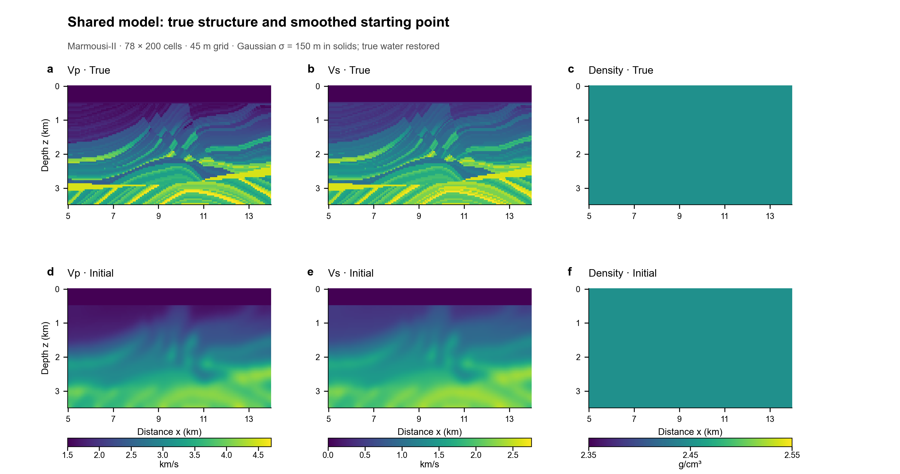
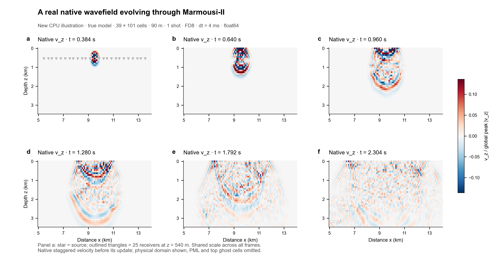
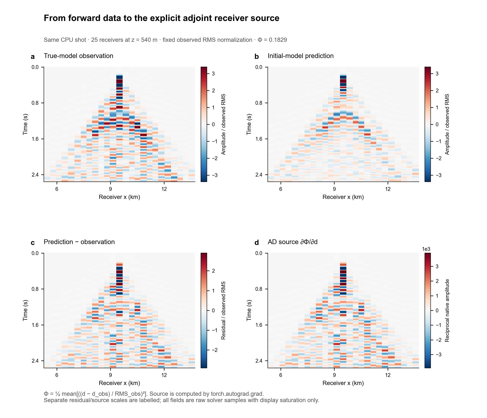
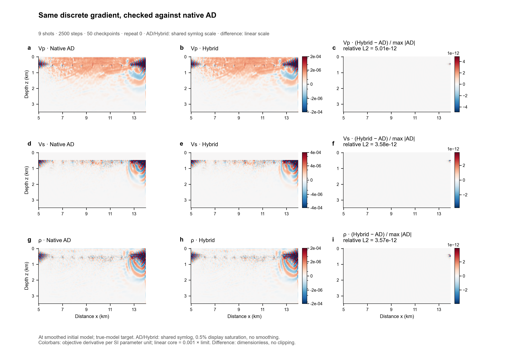
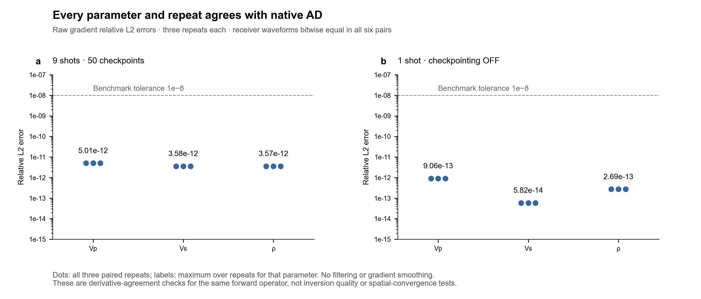
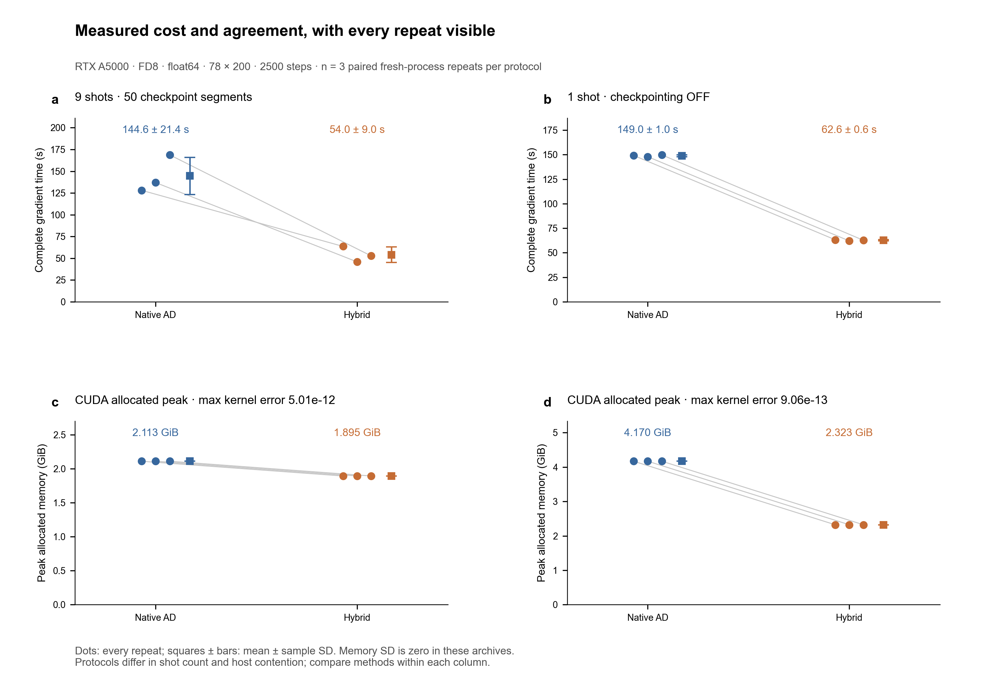

# HybridADFWI visual report

已完成的[已知真实 Vs／Vp-only 对照](VP_ONLY.md)使用新预测、残差和梯度，完整物理 Vp 与反演坐标均通过严格 AD 对照；同色标图也保留了未增加薄层细节的结果。

新增的 **6.25 m / 6 Hz Marmousi-II 梯度演示**见 [GRADIENT_DETAIL.md](GRADIENT_DETAIL.md)：包含实际层状敏感度、完整物理梯度与固定参数坐标梯度，以及边界失败控制。下面保留原始性能基准的独立可视化配置。

这些图把同一正演算子的求导对比连成一条可检查的证据链：**真实模型 → 平滑初始模型 → 波场与接收数据 → AD 数据导数 → 同一初始点的模型梯度 → 误差、耗时与内存**。没有进行模型优化，所以图中不存在“反演后模型”。图像均由 [Python 脚本](../scripts/visualize.py) 从实际输入、原生状态或归档输出生成。

| 图 | 主要问题 | PNG / 可编辑 PDF / 可编辑 SVG |
| --- | --- | --- |
| 模型 | 两种方法使用了什么输入？ | [PNG](figures/models.png) · [PDF](figures/models.pdf) · [SVG](figures/models.svg) |
| 波场 | 原生内核实际传播了什么？ | [PNG](figures/wavefields.png) · [PDF](figures/wavefields.pdf) · [SVG](figures/wavefields.svg) · [GIF](figures/wavefield.gif) |
| 数据与伴随源 | 残差如何进入显式伴随？ | [PNG](figures/data_adjoint_source.png) · [PDF](figures/data_adjoint_source.pdf) · [SVG](figures/data_adjoint_source.svg) |
| 梯度 | Hybrid 是否复现 Native AD？ | [PNG](figures/gradients.png) · [PDF](figures/gradients.pdf) · [SVG](figures/gradients.svg) |
| 逐重复精度 | 三种参数与全部重复是否一致？ | [PNG](figures/agreement.png) · [PDF](figures/agreement.pdf) · [SVG](figures/agreement.svg) |
| 资源 | 实际耗时与显存如何变化？ | [PNG](figures/performance.png) · [PDF](figures/performance.pdf) · [SVG](figures/performance.svg) · [CSV](figures/benchmark_points.csv) |

## Model



**真实与初始 Vp、Vs、ρ。** 第一行为真实模型，第二行为实际提供给两种求导策略的初始模型。源数据来自 University of Houston / AGL 的 Marmousi-II，归功于 Gary S. Martin、Robert Wiley 和 Kurt J. Marfurt。纸面网格为 78×200、45 m，模型坐标 x=5.000–13.955 km、z=0–3.465 km；物理网格点在图像像素中心，边缘延伸半个网格。每列两行严格共用色标，显示时不再平滑。

初始模型采用固体区归一化高斯平滑，σ=150 m，并恢复真实水层。本基准沿用固定密度 2450 kg/m³，因此密度两幅图确实相同，不能解读为密度重建结果。原始数据和准备后的输入数组不随代码分发；[数据来源与条款](DATA_PROVENANCE.md)、[纸面模型元数据](../evidence/marmousi2_paper.json)记录单位、来源校验和及准备方法。

## Wavefields



**真实 Marmousi-II 上的原生 `v_z` 波场。** 为图示新增本机 CPU 正演：39×101、90 m、单炮、25 接收器、640 步、dt=4 ms、5 Hz Ricker 矩张量源，源与接收器深度 540 m；FD8、split PML、自由表面、float64。图 a 的星号为源、空心三角为接收器。此网格用于启动与正确性示例，不能代替空间收敛或高分辨率传播验证；它与后面 GPU 性能证据的 78×200 / 2500 步配置不同。

状态来自现有的原生时间循环历史插桩，只添加保存五个场的写入。没有根据速度模型绘制假波前，也没有倒放或补帧重建。脚本将插桩生成的接收记录与未插桩的固定原生内核重新正演结果逐位比较，结果为相等。图示 `v_z` 是原生交错网格速度更新前的状态，t=i·dt；只裁去顶部 4 行 ghost cells 与侧面/底部 10 单元 PML。没有将交错分量重新插值到同一点。

六帧和 [80 帧动画](figures/wavefield.gif)共用一个 signed 线性色标，并除以全部 80 帧的同一个最大绝对振幅。色标上限由所选六帧的合并绝对值第 99.5 百分位确定，显示饱和比例逐帧记录在[图像清单](figures/manifest.json)中。没有逐帧自动增益或空间模糊。原生源幅值未做绝对物理标定，因此使用共同归一化幅值。动画播放为 15 fps，每帧相隔 32 ms 模拟时间，不是实时播放。

## Data



**从观测到 AD 接收器伴随源。** 使用上述同一个 CPU shot，依次显示真实模型观测、平滑初始模型预测、预测减观测，以及实际由 `torch.autograd.grad` 计算的数据导数。观测与预测共用色标，以观测 RMS 做固定归一化；残差与伴随源的独立色标均明确标出。接收器位置按实际取整后的网格坐标显示，没有假定它们完全均匀。

目标为 `Φ = 0.5 × mean[((d − d_obs) / RMS_obs)²]`；观测与 RMS 在求导时固定。这里 `∂Φ/∂d = (d − d_obs)/(N × RMS_obs²)`，因此纯 L2 下残差与伴随源具有相同的空间时间图案、不同的量纲和比例；它们不是两项独立的精度证据。脚本仍实际调用 AD 获取源，并保存与解析式的一致性检查。该源随后可传给 `tape.backward({'vz': source})`；这里的图示只展示源，不声称展示了反向传播的完整伴随波场。

## Gradients



**在实际平滑初始模型处求导，以真实模型正演记录为目标。** 展示已归档 GPU 9 炮 / 2500 步 / 50 段 checkpoint 的 repeat 0。每行对应 Vp、Vs、ρ，前两列为 Native AD 与 Hybrid 的原始梯度，第三列为 `(Hybrid − AD)/max|Native AD|`。所有误差在未处理数组上计算，梯度没有平滑、裁剪存储、照明预条件或优化器更新。

为同时看清强边缘与较小的内部敏感度，前两列在每个参数内共用**对称 symlog 色标**：base=10、线性核心为显示上限的 0.001 倍；显示上限取两种方法合并的绝对值第 99.5 百分位，每幅饱和 0.5% 单元。色标刻度仍是原始目标函数对 SI 参数的导数单位。第三列用独立的线性色标显示全部差值，不做饱和；其极小数量级标在色条顶部。不同参数和第三列不应凭颜色深浅直接比较绝对幅度。

| 参数 | Native AD / Hybrid 共同显示上限 | symlog 线性核心 | 仅显示饱和比例 | 原始梯度相对 L2 误差，repeat 0 |
| --- | ---: | ---: | ---: | ---: |
| vp | 1.5526e-04 | 1.5526e-07 | 0.5% / 0.5% | 5.011e-12 |
| vs | 3.9550e-04 | 3.9550e-07 | 0.5% / 0.5% | 3.576e-12 |
| rho | 1.7020e-04 | 1.7020e-07 | 0.5% / 0.5% | 3.569e-12 |

## Agreement



**三个参数、两种协议、每组全部三次重复。** 每个点均来自归档配对比较；标签为同一参数跨重复的最大相对 L2 误差，虚线为实验的 1e−8 接受阈值。两个协议的每次重复中，Native AD 与 Hybrid 的接收波形均逐位相等。此图验证同一离散算子的导数一致性，不检验模型恢复质量、空间收敛或不同求解器之间的物理误差。全部点同时导出为 [CSV](figures/benchmark_points.csv)。

## Measurements



**每个点都保留，按重复配对。** 圆点为三次独立进程测量，灰线连接同一重复的两种方法，方块和误差线为均值 ± 样本标准差（ddof=1）。显存采用 PyTorch 的 CUDA peak allocated；三个重复中该值相同，因此相应标准差为零。它不是 CUDA reserved、显卡总使用量或 CPU RSS。

| GPU 协议 | Native AD 时间，s | Hybrid 时间，s | Native AD / Hybrid allocated，GiB | 所有参数/重复的最大相对 L2 |
| --- | ---: | ---: | ---: | ---: |
| 9 炮，50 段 checkpoint | 144.62 ± 21.41 | 54.01 ± 8.98 | 2.11267 / 1.89532 | 5.01e−12 |
| 1 炮，无 checkpoint | 149.00 ± 0.96 | 62.64 ± 0.59 | 4.16962 / 2.32287 | 9.06e−13 |

9 炮配置存在 CPU 争用；跨两列的炮数、checkpoint 与主机条件不同，只能在各协议内比较方法。9 炮无 checkpoint 的容量检查中，Native AD 显存不足而 Hybrid 可完成；该未配对的失败尝试不混入完整梯度耗时图。原始 JSON、NPZ、协议和资源记录均保留，见[checkpoint 结果](RESULTS_20261106.md)、[无 checkpoint 结果](NO_CHECKPOINT_RESULTS_20261106.md)与[证据索引](../evidence/README.md)。

## Reproduce

从安装好本项目及固定上游 submodule 的源码目录运行。先查看[数据条款](DATA_PROVENANCE.md)，再准备两个实际模型：

```bash
python scripts/prepare_marmousi.py --preset paper
python scripts/prepare_marmousi.py --preset smoke
python scripts/visualize.py
```

默认生成六套 PNG/PDF/SVG 和一个 GIF，读取已有 GPU 归档，不需要 GPU 或 SSH。新 CPU 正演采用一个计算线程，生成的数据与波场缓存位于被 Git 忽略的 `.cache/visualization/`。后续重画读取缓存；`--refresh-capture` 强制重新计算，`--no-gif` 省略动画，`--only models|gradients|performance|agreement|wavefields|data` 可只更新一张图。更换输入时仍需满足归档所用模型配置，不能把别的模型与归档梯度拼接。`--paper-model` / `--smoke-model` 可指定本机准备文件位置。

[manifest.json](figures/manifest.json)记录模型、源代码和波场缓存哈希，模型单位与平滑参数、固定上游 commit、CPU 状态来源/配置/运行库、全部显示饱和比例、原始数组摘要、原生接收记录逐位验证，以及数据导数解析式检查。原始 SEG-Y、准备后的输入模型和本机缓存均不随代码分发。图像是研究输出，代码的 MIT 许可不改变输入数据的权利；[AGL 原始下载页](https://www.agl.uh.edu/downloads/downloads.htm)。

[图像契约](FIGURE_CONTRACT.md)定义每张图的科学问题和显示边界；[QA 记录](figure-qa/README.md)记录最终布局、字体、碰撞与逐面板检查。PNG 为 300 dpi，PDF/SVG 保持文字可编辑。这些是适合代码仓库和报告阅读的页面尺寸；正式投稿时应按目标期刊版心重新布局并复查字体，不能直接把整页缩到单栏。
