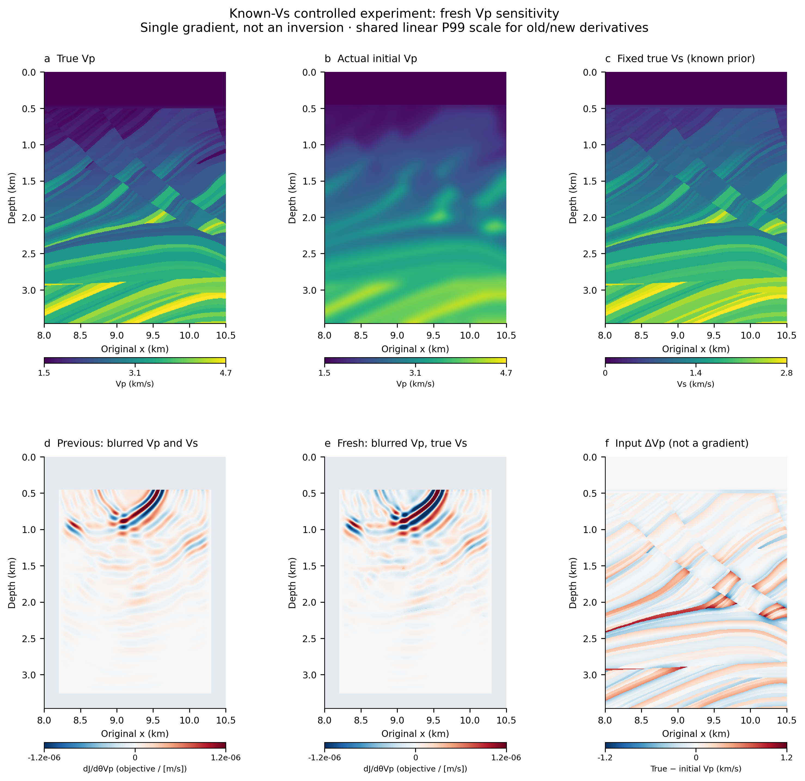
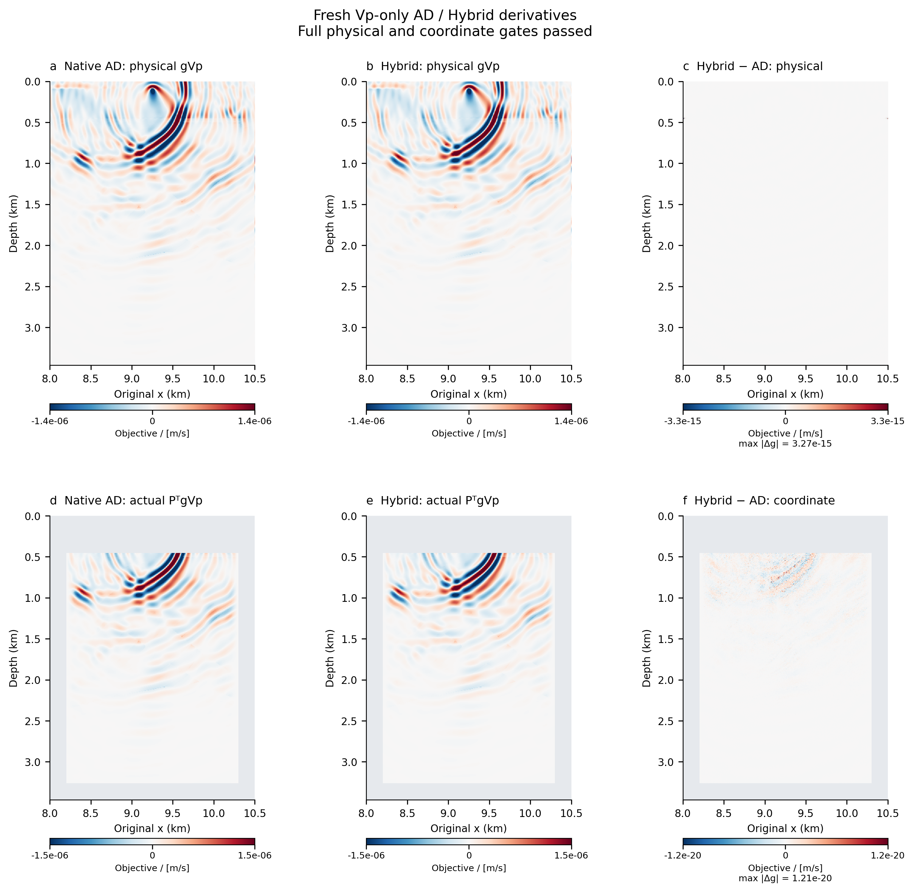

# Vp sensitivity with known true Vs

This controlled Marmousi-II experiment fixes the true Vs and the existing
known constant-density field. Only Vp is blurred and differentiated. It tests
whether removing Vs mismatch makes the Vp response easier to interpret; it does
not assume that fixing a parameter guarantees finer resolution.



| Field | Observed-data model | Starting model | Updated coordinate |
|---|---|---|---|
| Vp | Prepared true Vp | The same sigma = 60 m Gaussian Vp as the earlier example | Vp only |
| Vs | Prepared true Vs | Exactly the same true Vs | Fixed |
| Density | Known constant 2450 kg/m³ | Exactly the same constant field | Fixed |

The solver still propagates the complete native elastic P–SV wavefield. Fixed
Vs enters every forward calculation. The known Vs structure is an explicit
synthetic prior, not a recovered result or information inferred by the gradient.
The density convention is the existing constant-density control, rather than
the variable density in the original Marmousi-II source data.

The horizontal ROI remains x = 8…10.5 km and depth = 0…3.4625 km, with a
555×401 grid at 6.25 m. The 6 Hz source and pressure receivers are in water at
100 m depth. One central shot, the absorbing top, 600 m PML, fixed damping
profile, known-water data window and declared Vp coordinate map are retained.
The physical starting field is checked after `model.forward()`; disabling a
parameter's gradient alone does not establish that its true values were used.

## A new residual and a new gradient

Both routes run this new starting model. Its prediction, residual, pressure
VJP and adjoint are recomputed. The old multiparameter Vp gradient is only a
labelled comparison, not the new experiment's derivative.

The data target still uses true Vp, true Vs and the same density control. True
target traces, window and objective normalization are checked against the
earlier example. The model map remains
`Vp(theta) = Vp_initial + P*(theta - Vp_initial)`, with known water and the
existing initial-valued lateral/bottom Vp buffer fixed. Outside-coordinate Vp
errors can therefore remain; true Vs is fixed everywhere, including the buffer.

Independently combining blurred Vp and true Vs changes the elastic moduli.
The material screen checks finite fields, positive density, positive solid
shear modulus and positive bulk modulus, with acoustic water treated separately.
Negative lambda, if present, is recorded rather than silently clipped.
Here the mixed initial model has 1328 negative-lambda cells, with minimum
lambda approximately −6.783 GPa, while its minimum bulk modulus is positive
at 3.645 GPa. Independent array checks confirm that no Vp/Vs repair or extra
smoothing was used.

## Numerical and visual result

The fresh pair passes the original 10⁻⁸ comparison gate for both meanings of
the Vp derivative:

| Check | Result |
|---|---:|
| Full physical Vp gradient, AD/Hybrid relative L2 | 2.76×10⁻¹¹ |
| Actual Vp coordinate derivative, AD/Hybrid relative L2 | 1.87×10⁻¹⁵ |
| Previous blurred-Vp/blurred-Vs initial objective | 0.3727100132 |
| New blurred-Vp/true-Vs initial objective | 0.5618460904 |

Fixing true Vs does not automatically reduce the data misfit: the new value
is larger. Parameter errors can interact in the waveform response, but the
observed loss difference alone does not identify a particular compensation
mechanism. This experiment changes the actual Vs used in propagation and thus
both the residual and the Vp sensitivity operator. It is not a comparison of
trainable flags at an otherwise identical physical starting model.

The old and new coordinate-gradient panels share a single symmetric linear
P99 bound computed from their concatenated fully active samples. Their overall
spatial forms remain similar; this run does not demonstrate new thin-layer
resolution. The Vp squared-gradient fraction below 1 km decreases from 14.53%
to 11.86%, and below 2 km from 0.799% to 0.453%. These are within-parameter
Euclidean diagnostics, not wave energy or reconstruction accuracy.

| Single cold functional run | Native AD | Hybrid |
|---|---:|---:|
| Complete derivative time | 545.23 s | 133.02 s |
| Peak CUDA allocated memory | 5.774 GiB | 6.096 GiB |

Hybrid uses slightly more allocated GPU memory in this particular Vp-only,
checkpointed run. These single observations are retained rather than presented
as a repeated performance benchmark or evidence of universal memory savings.
The original repeated three-parameter benchmarks remain a separate experiment.



The actual coordinate derivative and the auxiliary physical derivative are
saved separately. The original 10⁻⁸ agreement gate is retained. Any failed
full-physical comparison remains a failure even if the predeclared coordinate
derivative passes. This new run does not overwrite the earlier case or its
failed-gate record.

All gradient panels use actual derivatives with explicit linear display
limits and recorded saturation. No gradient smoothing, depth gain, sharpening
or true-model texture is added. `true Vp - initial Vp` is labelled as an input
correction and is never called a gradient. Time and memory from this cold
functional run are not replacements for the repeated performance benchmarks.

## Reproduction and evidence

Starting from a fresh checkout, prepare the parent model and then the
known-Vs model. Skip preparation commands only if those exact cached inputs
already exist; both scripts preserve prior namespaces.

```bash
python scripts/gradient_detail.py prepare-model \
  --config configs/gradient_detail_reflection_candidate.json \
  --raw-dir data/raw/marmousi2
python scripts/gradient_detail_vponly.py prepare-model \
  --config configs/gradient_detail_20261107_vponly_replay.json
python scripts/gradient_detail_vponly.py run \
  --config configs/gradient_detail_20261107_vponly_replay.json \
  --output runs/my-vponly
python scripts/collect_vponly_evidence.py --run runs/my-vponly \
  --output evidence/my-vponly --pressure-output .cache/my-vponly-pressure
python scripts/plot_vponly_detail.py --evidence evidence/my-vponly \
  --previous-evidence evidence/gradient-detail-reflection-candidate-20261107 \
  --model data/prepared/marmousi2_detail_full_depth_6p25m_20261107_vponly.npz \
  --output docs/figures/my-vponly
```

The replay configuration does not require private old observations. Its
old/new comparison can use the published complete-array pressure/window hashes
and fixed RMS; the figure manifest identifies that evidence as hash matching,
rather than direct rereading of the old arrays. The archived experiment did
perform the direct full-array bit comparison. Local and remote model container
hashes may differ with metadata; every displayed physical field is checked
against its actual execution array hash.

See [strict numerical evidence](../evidence/gradient-detail-20261107-vponly/independent_audit.json),
[full pressure/source audit](../evidence/gradient-detail-20261107-vponly/full_pressure_source_receipt.json),
[depth diagnostics](../evidence/gradient-detail-20261107-vponly/gradient_depth_diagnostics.json)
and the [final figure QA](figures/vponly/qa/visual_qa.json).

Public evidence contains complete Vp derivative arrays, coordinate geometry,
source/runtime provenance and numerical checks. Evaluated model inputs stay
local and are regenerated from the checked source models. If receiver evidence
is sampled, the exact axes and full objective normalization are stated; it is
not represented as a complete recording.

See the earlier [multiparameter experiment](GRADIENT_DETAIL.md) for its separate
initial models, validation scope and boundary-control history.
